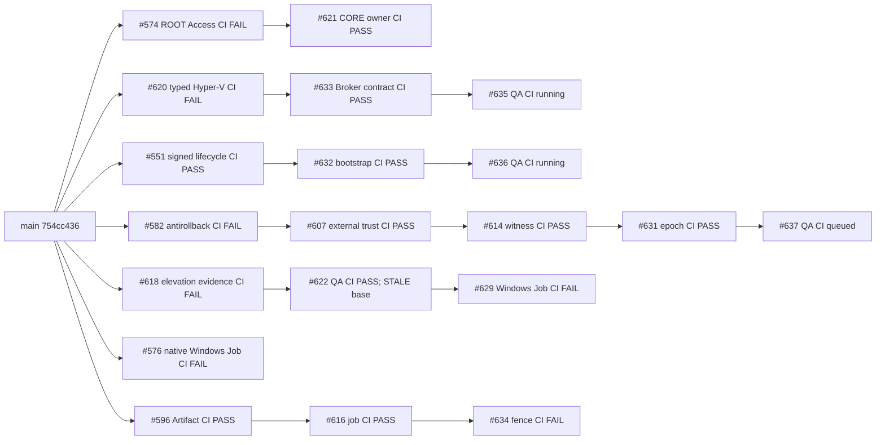

# P0 Worker #24: independent integration DAG and CORE critical path (2026-10-21)

> Source-only. **PRODUCTION NO-GO.** No PR in this graph is authorized for automatic merge, installation, Broker activation, UAC approval, VM action, or Agent upgrade. `ReVoltVPN-Ubuntu-Lab` is strictly out of scope.

## Reproducible GitHub provenance

- Repository: `Naveax/Nexowire`; sampled `main`: `754cc4364822be5fda528f54042fb22a84f19924`.
- Snapshot: [p0-integration-dag-20261021.json](./p0-integration-dag-20261021.json): **38** open PRs. GitHub branch bases, exact 40-hex HEADs and corresponding **CI** workflow run IDs were collected with `get_pr_info` + `fetch_commit_workflow_runs`. Release Readiness success is *not* substituted for CI failure.
- 12 selected comparisons use `compare_commits(base SHA, head SHA)`; no merge-base assertion is made for the remaining 26. Changed-file claims are **sampled**, and do not constitute exhaustive conflict detection or an ownership grant.
- Exact versioned validator: `scripts/qa24-integration-dag.ts`. Negative test suite: `test/qa-24-integration-dag.test.ts`.
- Local, read-only reproduction (Node >=22, checked-out **exact PR SHA**):
  ```sh
  npm ci
  node --test --import tsx test/qa-24-integration-dag.test.ts
  node --import tsx scripts/qa24-integration-dag.ts > qa24-findings.json
  # Exit 2 is EXPECTED: it means the snapshot contains blocking findings.
  ```
  Re-running does **not** refresh the pinned GitHub snapshot; fetch new PR metadata, SHA-specific CI and merge-base evidence explicitly before claiming current status.

## Confirmed stacked DAG



The graph is **illustrative**, not a declaration that all root PRs are rebased onto the current main. Original parent-child edges are in the JSON; a root arrow denotes conceptual ancestry from main, not a verified latest-main merge base.

## Concrete blocking findings

1. **Stale children:** #622 is based on `512a1764...` while current #618 HEAD is `4e66122d...`; #609 is based on `91c69f66...` while current #576 HEAD is `a3946c1f...`. A previous green child CI does not validate the current parent.
2. **Main divergence:** checked root comparisons for #574, #620 and #551 are `diverged`, with merge bases `822cb26f...`, `4c5c8101...` and `4c5c8101...` respectively, *not* current main `754cc436...`. Reconcile branch history before integrations; no force-push and no unsupervised rebase of another worker's branch.
3. **Parent red:** #633 PASS is stacked on #620 FAIL (Windows Hyper-V trust fixtures). #621 PASS is stacked on #574 FAIL (hosted Windows Job regressions). #629 FAIL on Windows Job `browser-live`; #634 FAIL on Node22 `Run npm run check`. Those remain blocked.
4. **Overlapping independent Windows Job work:** #576, #629 and #633 each list `.github/workflows/ci.yml`, `native/windows-job-owner.c`, `src/agent/process-manager.ts` and `src/agent/windows-job-owner.ts`. Do not combine by blindly applying patches. #00 integrator and #03 owner should nominate one exact signed helper SHA and reconcile source once.
5. **No physical authority proof:** PostgreSQL in-memory witness and signed source provenance are **not** an actual off-host monotonic CAS. GitHub green tests are not Authenticode publisher acceptance, SYSTEM/high-token verification, protected parent/import-tree ACL, local UAC confirmation, or real device Broker readback.

## Fastest defensible route to real CORE

**A. Owner delegation:** #04 owner reconciles #574 onto current main and makes the exact-head Windows CI green, then #621 and UI effective-state mapping only after owner/epoch revocation and ROOT 15-minute expiry are tested. FULL remains standard-user; requesting CORE cannot masquerade as elevated execution.

**B. Trusted irreversible authority:** #01 owner reconciles #582/#607/#614/#631 and uses a real independently hosted monotonic CAS with atomic reservation, rollback prevention, signed owner-device-session epochs and revocation. Synthetic tests stay SOURCE PASS / PHYSICAL BLOCKED.

**C. Installer and high-token executor:** #12/#03 owners reconcile #551/#632 and #620/#633 respectively on agreed exact commits. Audit pinned Authenticode publisher, trusted signed rollback, updater and parent/import-tree ACL, SYSTEM/high token, version and instance identity, DPAPI binding. A normal one-time local UAC enrollment must be observed on an authorized disposable Windows acceptance environment; no further per-command UAC for already authorized CORE operations. Do not route generic `shell.exec` to elevated without signed Broker admission. #576/#629 Windows Job conflicts and red CI must be handled on the canonical helper source.

**D. Independent acceptance before any merge/deploy:** #00 integrator validates fresh SHA+CI of all parent/child chains, performs an isolated merge rehearsal, runs exact integration tests and requests a separate physical high-token, revoke, replay-UNKNOWN and reboot/persistence readback gate. Agent v1.0.5 medium-integrity and missing trusted Broker remain PHYSICAL BLOCKED. Do not use `consent.exe`, HTTP 401, an in-memory witness, or CI success as equivalent proof.

**Deferred independent thread:** #596 -> #616 -> #634 Artifact chain is important but not a shortcut to Windows CORE. #634 red cancellation negative must be fixed by #08 and source tests must not cause live transfers.

## Interpretation

- The DAG audit is a **review gate**, not an auto-merger.
- `OWNER_COLLISION` flags same-file cross-lineage review requirements; it is not a Git content-conflict verdict.
- `STALE_PARENT_SHA` and `STALE_MERGE_BASE` require a newly verified exact HEAD.
- `CI SUCCESS` refers only to the matched commit's GitHub workflow; production remains NO-GO.
- No owner implementation, installed Agent/Broker, user files, services, UAC, VM or production repository branch were changed by this worker.
